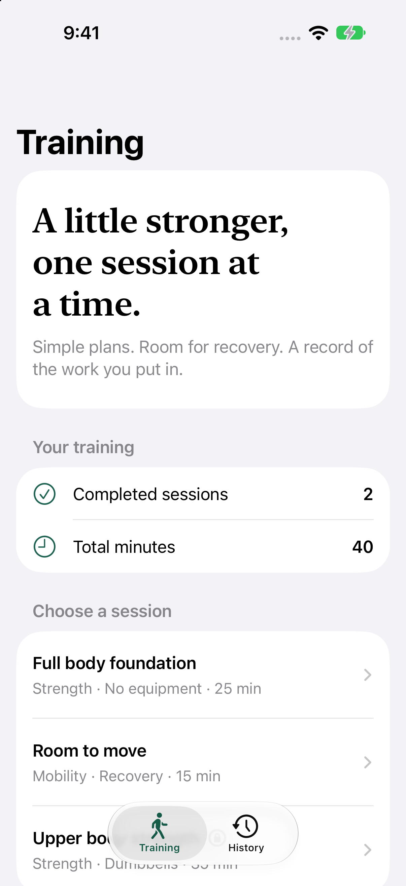

# Subscription Fitness Planner

A focused workout planner with local history and a complete StoreKit 2 membership flow.

**iOS 15+ · Swift · MIT License**

## What it does

- Follow two free routines and a membership-only strength session.
- Schedule workouts by date, check off exercises, and save completed sessions locally.
- Purchase monthly or yearly membership, restore access, and react to transaction updates.
- Test purchases, refunds, and expiration with the included local StoreKit configuration.

## Run

Open `Subscription Fitness Planner.xcodeproj` in Xcode 16 or later. The shared scheme has the same name. No third-party Swift packages are required. Builds were checked with Xcode 27; minimum OS declarations are not a claim that every older OS was runtime-tested.

Select an iPhone or iPad simulator and run the shared scheme. Its StoreKit configuration uses fictional local products and does not charge money.

For device or App Store distribution, choose your own signing team and register your own products. No developer account identifiers are committed.

Bundle identifier: `com.dd.fitnessplanner`.

## Try it

Open Full body foundation, check each exercise, complete the session, then open History. Open the membership screen to test local purchases. Xcode’s Debug → StoreKit → Manage Transactions lets you exercise other states.

## Implementation

`Sources/Core` holds workout definitions and history calculations. `TrainingStore` owns atomic JSON persistence. `SubscriptionStore` verifies transactions, refreshes entitlements, and observes StoreKit updates. Views only request these operations.

## Verification

Run `swift test` for history and model tests. In Xcode, use Product → Test for the StoreKit integration suite (iOS 17+ test runtime; the app itself supports iOS 15). Run simulator purchase tests with normal simulator signing; disabling code signing prevents reliable StoreKit identity verification.

## Scope and limitations

The routines are a small example library, not a personalized training service. There is no account system, HealthKit integration, or cloud history. Local StoreKit tests do not establish production App Store server behavior.

## Data and privacy

See [PRIVACY.md](PRIVACY.md) for storage and network behavior. Sample data is fictional.

## License

[MIT](LICENSE). Original source and app artwork are included under the same license.
